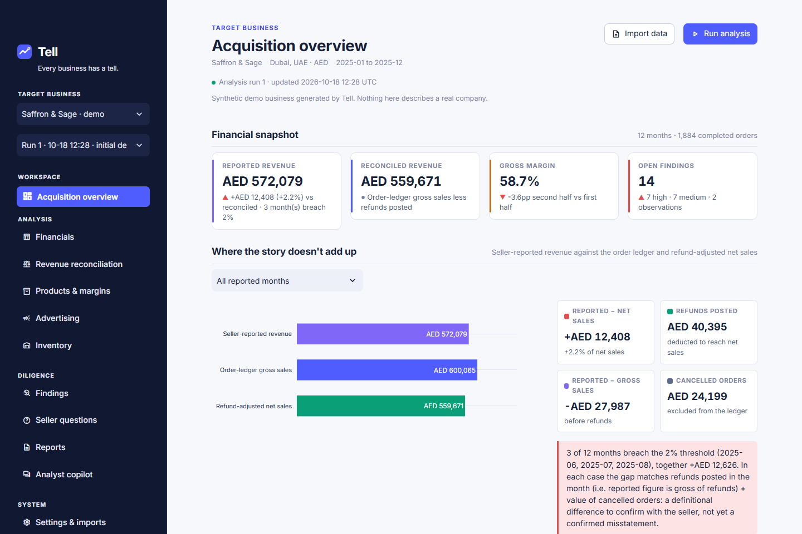
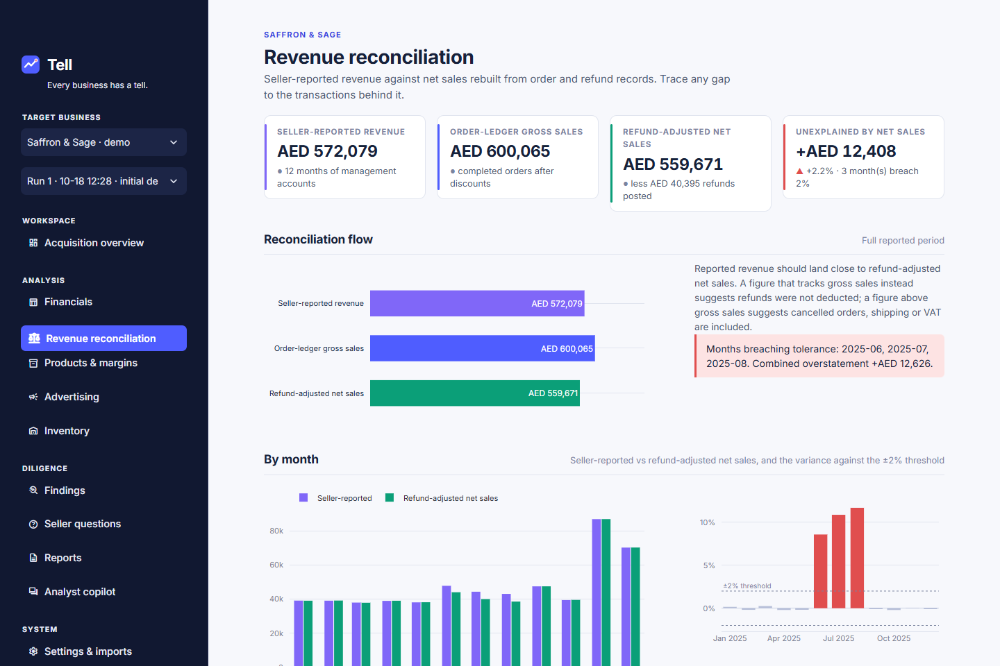
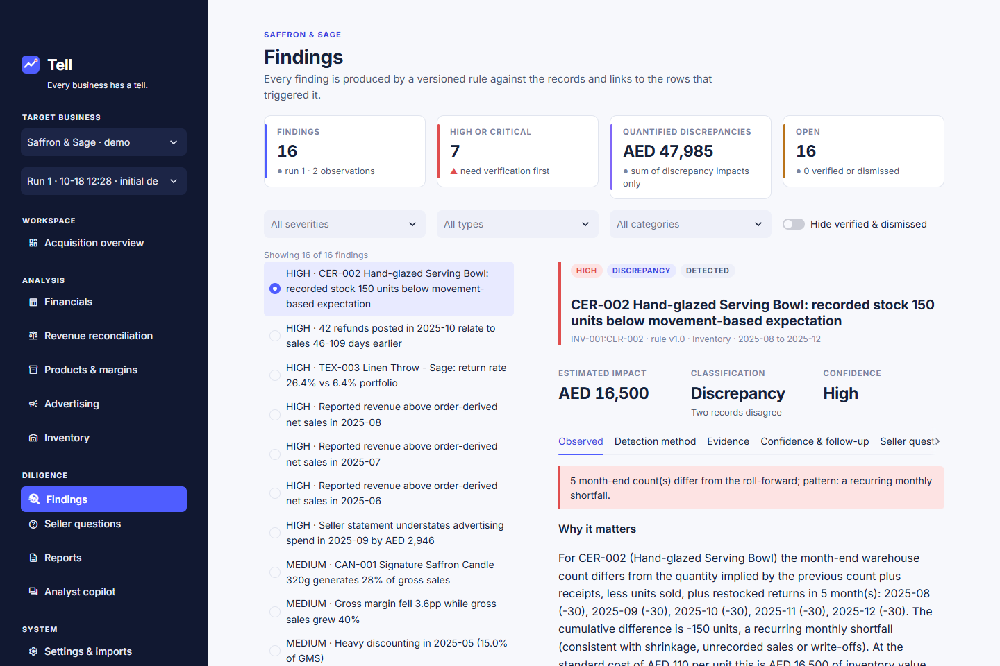
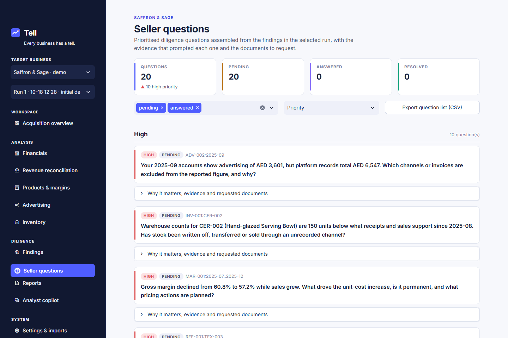
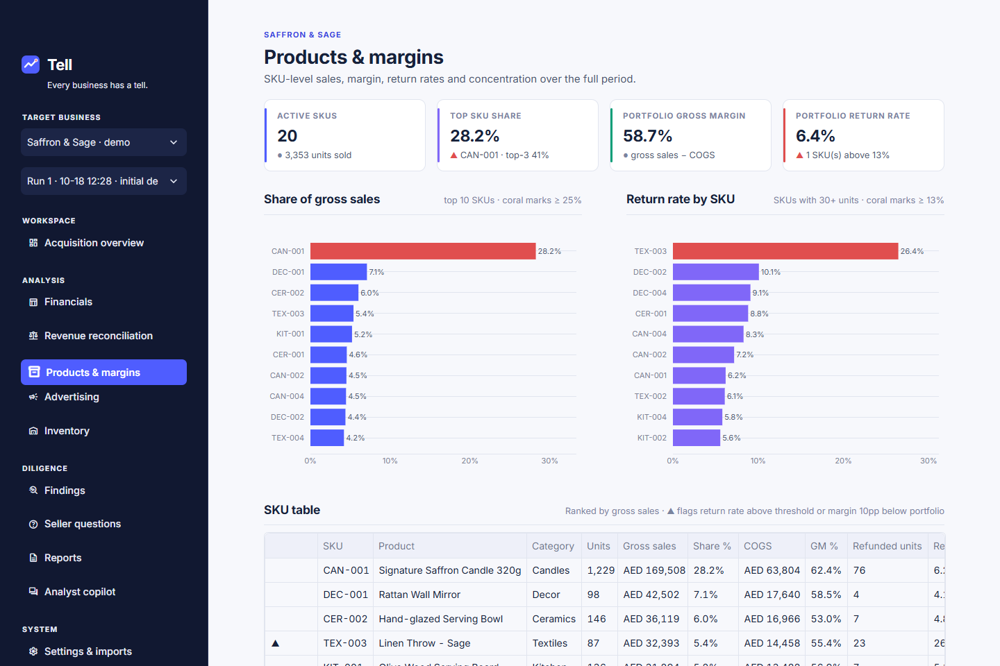
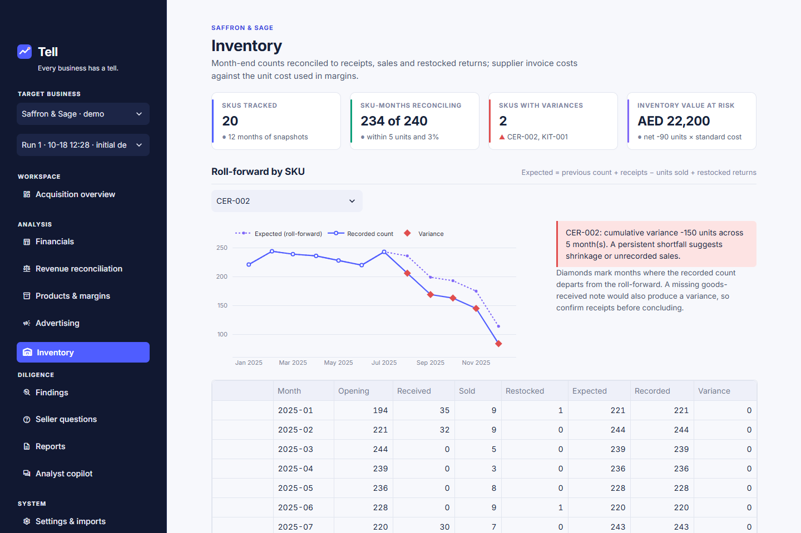
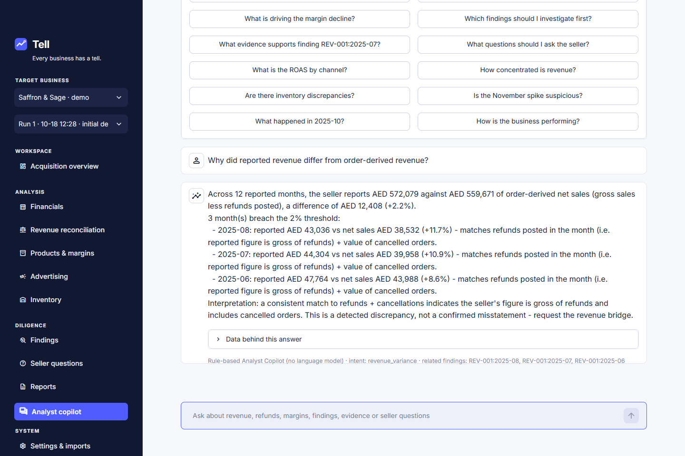

# Tell

**Every business has a tell.**

Tell is an acquisition-diligence intelligence workspace for e-commerce businesses. It ingests a
seller's orders, refunds, advertising, inventory, supplier costs and management accounts,
reconciles them against each other, detects inconsistencies and risks, quantifies their impact,
links every finding to the underlying records, drafts the questions to put to the seller, and
produces a structured diligence report.

It runs entirely offline on SQLite. No API keys, cloud services or language models are required;
the analyst copilot is explicitly rule-based.

> Portfolio project built for an e-commerce private-equity audience. The bundled business
> ("Saffron & Sage") is synthetic and describes no real company. Tell is a decision-support tool,
> not an automated approval system: it reports *detected discrepancies* and *suspected risks*,
> never confirmed facts.



## Quick start

Requires Python 3.11 or 3.12.

```bash
git clone https://github.com/pasta55999/tell.git
cd tell
python -m venv .venv
# Windows: .venv\Scripts\activate      macOS/Linux: source .venv/bin/activate
pip install -r requirements.txt
streamlit run streamlit_app.py
```

First launch creates `data/tell.db`, seeds the demo business and runs the initial analysis
(about two seconds). The database persists across restarts; re-launching never duplicates the
demo data. Reset it from **Settings -> Analysis & demo data** (requires typing `RESET`).

Optional environment variables are listed in `.env.example` (database path, upload limit).

## What it does

| Area | Capability |
|---|---|
| **Revenue reconciliation** | Seller-reported revenue vs net sales rebuilt from orders and refunds, monthly variance, automatic attribution of the gap to refunds / cancellations / shipping / discounts, per-month bridge (waterfall) and drill-down to the orders and refunds behind it, CSV export |
| **Profitability** | GMS, discounts, gross sales, refunds, net sales, COGS, gross profit/margin, advertising, contribution proxy (explicitly *not* EBITDA), H1 vs H2 margin decomposition into unit cost vs price, SKU cost drift |
| **Refunds & returns** | SKU return rates with minimum sample sizes, late-posted refund clusters (lag analysis), order-cohort refund spikes |
| **Advertising** | Spend by channel and month, intensity vs sales, statement-vs-platform variance, ROAS *only* for channels with platform attribution |
| **Concentration** | SKU and category share, top-SKU share trend |
| **Inventory & suppliers** | Month-end count roll-forward (opening + receipts - sold + restocked), shrinkage / phantom-stock detection, negative stock, supplier invoice cost vs recorded unit cost |
| **Seasonality** | Robust-z spike detection with a classifier that separates *seasonal observation* from *suspicious spike* using volume, AOV, ad scaling, margin and refund checks |
| **Findings workspace** | Severity, classification (discrepancy / suspected risk / observation), status workflow, measured values, method, evidence rows with source-record drill-down, impact basis, seller questions |
| **Seller questions** | Per-finding and consolidated questions with rationale, evidence and requested documents; pending / answered / resolved tracking; CSV export |
| **Reports** | Versioned report per run; PDF, JSON and CSV exports (findings, questions, reconciliation) |
| **Analyst copilot** | Rule-based intent recognition over 12 supported question types, answered from database calculations with evidence references; unsupported questions are declined |
| **CSV import** | Seven dataset types, column auto-detection and manual mapping, type/date/period parsing, row-level errors, duplicate file and row detection, preview, transactional import, history |
| **Reproducibility** | Each run stores a data hash, rule versions and skipped analyses; runs can be compared (new / resolved / changed) |

### Screens

| | |
|---|---|
|  |  |
|  |  |
|  |  |

### Design system

Tokens live in `tell/ui/theme.py` (colours, type scale, spacing, radii, shadows, component
states) and `.streamlit/config.toml` (base theme incl. the navy sidebar). Colour is semantic:
cobalt for primary actions, active navigation and the order-ledger series; violet for
seller-reported figures and secondary series; emerald for refund-adjusted / favourable signals;
coral only for material discrepancies and high-severity findings; amber for medium priority.
Every chart uses the same palette and `theme.plotly_layout`; tables use tabular numerals and a
`▲` flag column so meaning is never carried by colour alone.

## Demo dataset and planted scenarios

`Saffron & Sage` is generated deterministically (seed `20250101`): 20 SKUs, ~1,960 orders over
Jan-Dec 2025, ~200 refunds, 48 ad-spend rows, ~130 supplier receipts, 260 inventory snapshots and
12 seller statements, all internally consistent under documented rules. Eleven diligence
scenarios are planted, including one **hard negative** (a legitimate November peak that must be
reported as an observation, not a risk). Details: [docs/demo_dataset.md](docs/demo_dataset.md);
labels: [data/demo/ground_truth.json](data/demo/ground_truth.json) (used only by tests and the
evaluation suite, never by the application).

The engine detects all of them from the records:

| Finding key | Scenario | Severity |
|---|---|---|
| REV-001:2025-06/07/08 | Reported revenue gross of refunds and incl. cancelled orders | high |
| REF-002:2025-10 | 42 refunds posted 46-109 days after Jul/Aug sales | high |
| REF-001:TEX-003 | Linen Throw return rate 26% vs 6% portfolio | high |
| ADV-002:2025-09 | Advertising understated by 45% in September statement | high |
| INV-001:CER-002 | 150 units of unexplained shrinkage | high |
| CON-001:CAN-001 | Hero candle = 28% of gross sales | medium |
| MAR-001 | Margin -3.6pp while sales +40% (unit cost +10%, price flat) | medium |
| DSC-001:2025-05 | 15% discount rate vs 2.6% median | medium |
| INV-001:KIT-001 | 60 units of phantom stock | medium |
| INV-003:DEC-001 | Supplier invoices +15% vs cost used in COGS | medium |
| SEA-001:2025-11 | November peak: **seasonal observation**, not a risk | info |

## Evaluation

`python -m evaluation.run_eval --write` regenerates [EVALUATION.md](EVALUATION.md).

| Metric | Result | Denominator |
|---|---|---|
| Scenario recall | 11 / 11 | planted scenarios (hard negative must satisfy its constraints) |
| Finding-key precision | 16 / 16 | all produced findings, observations included |
| Finding-key recall | 13 / 13 | primary expected keys |
| F1 | 1.00 | |
| Value checks | 5 / 5 pass | gross-sales, line-sum, refund, net-sales identities; clean months within 0.5% |

These numbers show the implementation is correct on a labelled synthetic dataset whose rules and
scenarios were written together; two thresholds were tuned after inspecting demo output (see
EVALUATION.md). They do not measure generalisation to real businesses. Rules that the demo does
not trigger (ADV-001, CON-002, INV-002, DQ-001) are covered by unit tests with constructed inputs.

## Tests

```bash
pytest                                  # 91 tests, ~2 min (UI smoke tests use Streamlit AppTest)
pytest --ignore=tests/test_ui_smoke.py  # fast subset, ~20 s
```

Coverage: schema idempotence and persistence; deterministic demo generation and reset; financial
conventions (GMS/discount/net-sales/refund identities, margin and return-rate denominators,
ROAS withheld without attribution, missing costs not imputed); every planted scenario and the
hard negative; no unexpected findings; evidence rows reference real records; identical repeated
runs; run comparison on changed data; status updates; rules on constructed inputs; CSV parsing,
mapping, validation, duplicates, transactional rollback, SQL-injection and formula-injection
safety; copilot intent classification and all supported answers; report structure and
PDF/JSON/CSV exports; report versioning; operation with no API keys; all pages render before and
after a run; primary interactions (run analysis, finding status, copilot).

## Methodology and architecture

- [docs/methodology.md](docs/methodology.md) - definitions, every rule with thresholds, classification vocabulary, impact bases, reproducibility.
- [docs/architecture.md](docs/architecture.md) - module layout, data flow, schema summary, security notes.
- [docs/demo_dataset.md](docs/demo_dataset.md) - generation rules, planted scenarios, limitations.

Stack: Python 3.11, Streamlit, SQLite, pandas, Plotly, pydantic, ReportLab, pytest.

## Importing your own data

**Settings -> Import data** accepts CSVs for products, orders (one row per line item), refunds,
ad spend, seller statements, inventory snapshots and supplier receipts. Columns are auto-detected
from common export names (Shopify-style `Lineitem sku`, `Financial Status`, etc.) and can be
remapped; a template is downloadable per dataset. Rows failing validation are listed with the row
number, field and reason, and nothing is written until you confirm. Re-importing the same file is
detected; rows whose natural key already exists are skipped and counted.

## Optional language model

The copilot's `LanguageModelAdapter` protocol (`tell/copilot/adapters.py`) lets a local or hosted
model classify free-text questions into the supported intents or rephrase a deterministic answer.
No adapter ships enabled and none is needed; a model would never generate SQL or add facts.

## Limitations

- Synthetic data: no repeat-customer structure, no VAT/fees/fulfilment cost, one year of history.
- Heuristic thresholds: documented and versioned, but not calibrated on real deal data.
- Contribution proxy stops at gross profit less advertising; it is not EBITDA.
- Single-user local application; no authentication or multi-user concurrency controls.
- PDF export is text-first (no charts).

## Licence

MIT.
